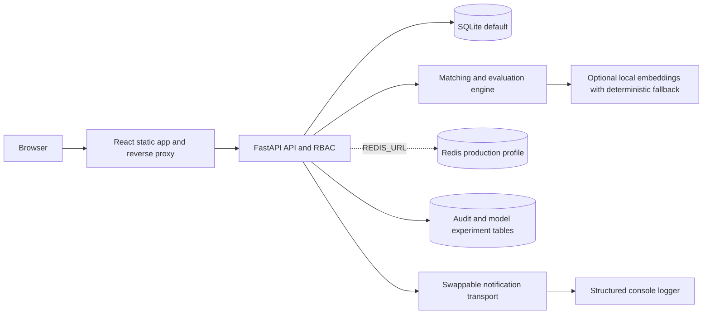

# Architecture

SQLite is the only implemented database. `DATABASE_URL` accepts `sqlite:///...`
and rejects unsupported databases at startup. The optional Compose PostgreSQL
service does not connect to the application; a repository and schema migration
is required first. `REDIS_URL` enables shared rate limiting only. Rankings remain
cached in the API process. Notifications write structured console events;
there is no email delivery or external LLM integration.

The browser validates saved identities with `/api/auth/me` and retries expired
API calls once after rotating a refresh token. ADMIN, RECRUITER and CANDIDATE
routes load separate page bundles. Staff accounts are provisioned locally;
public registration only creates candidates. Candidate endpoints enforce resume
ownership. Recruiters share a single workspace; do not onboard unrelated tenants.

Database handles close after transactions. Each ranking batch commits once,
then enters the process-local TTL cache. Changes to resumes, jobs, explicit
matches and pipeline stages invalidate relevant cache entries. Transport body
limits precede multipart parsing; resume size and archive expansion limits
precede document parsing. Uploaded bytes live outside the static web root.

See [the source audit](docs/PROJECT_AUDIT.md), [verification results](docs/VERIFICATION.md)
and [deployment runbook](PRODUCTION.md) for boundaries and remaining work.
