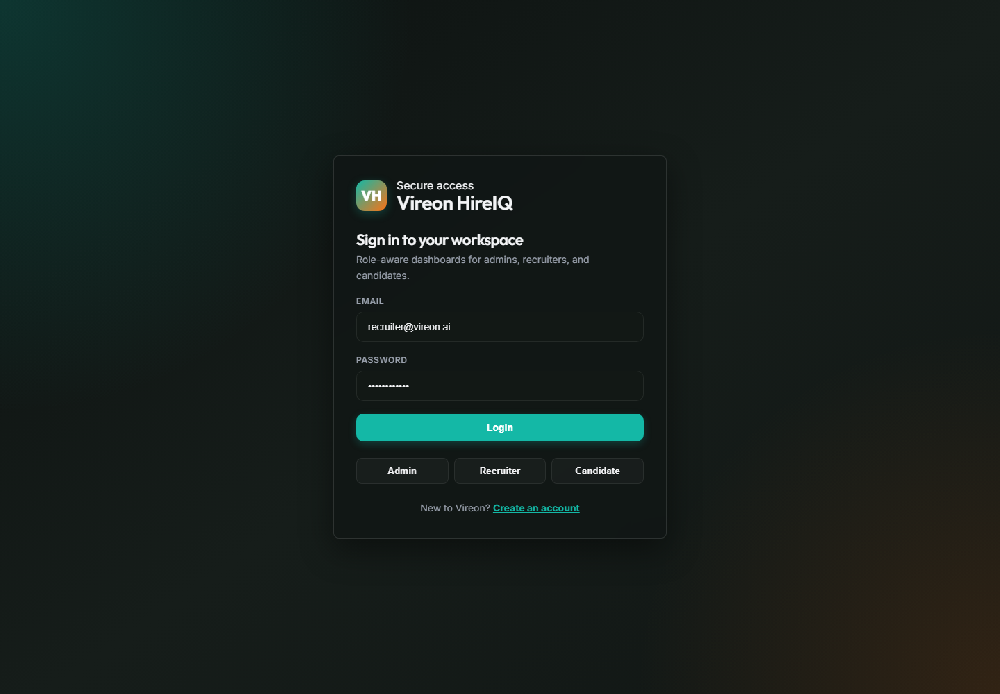
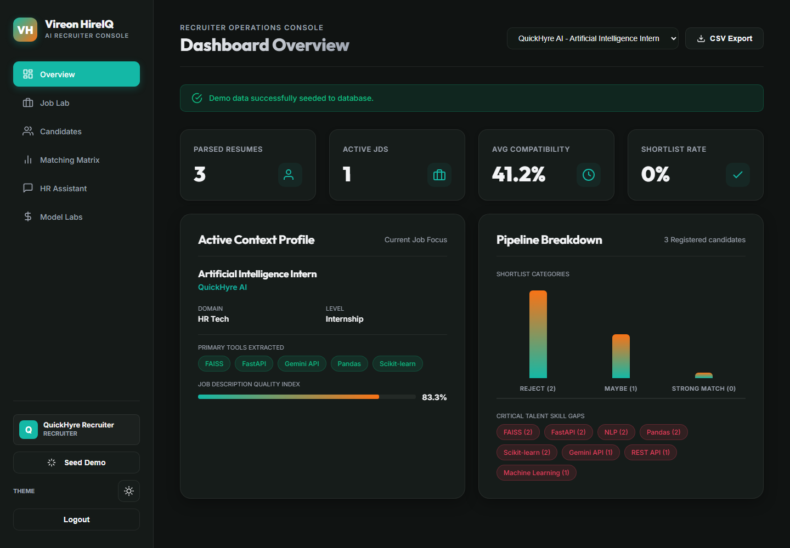
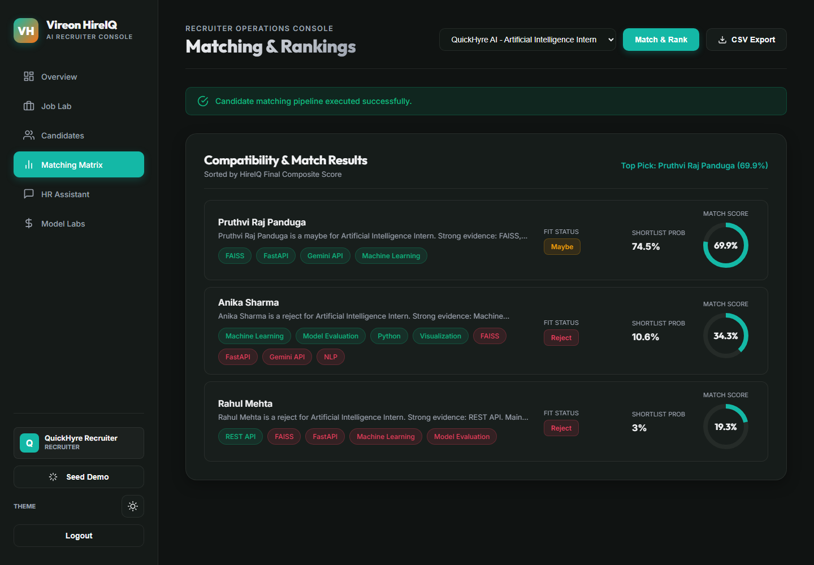

# Vireon HireIQ


Vireon HireIQ is an AI hiring intelligence console for ATS, job portal, and HRMS workflows. It parses resumes, analyzes job descriptions, ranks candidates, estimates shortlist fit, explains candidate evidence, generates interview kits, and gives recruiters a grounded HR assistant over candidate evidence.

## Current audit and verification

See [project audit and prioritized roadmap](docs/PROJECT_AUDIT.md),
[current verification](docs/VERIFICATION.md), [architecture](ARCHITECTURE.md),
[measured local performance](docs/PERFORMANCE.md), and
[deployment and recovery runbook](docs/DEPLOYMENT_RUNBOOK.md).
The [remaining feature roadmap](docs/FEATURE_ROADMAP.md) covers implementation
costs, frontend/backend changes and testing requirements for the next stages.
Shortlist values are heuristics rather than validated hiring probabilities.
Public registration creates candidates only; staff accounts require local
provisioning. Candidate/admin routes now have dedicated dashboards. The supported
deployment remains one organization and one API process with durable SQLite.

## Screenshots

The screenshots below were captured from a live seeded local run.

| Secure login                                              | Recruiter overview                                                                     |
| --------------------------------------------------------- | -------------------------------------------------------------------------------------- |
|  |  |

| Matching matrix                                                                    |
| ---------------------------------------------------------------------------------- |
|  |

## What It Does

- Parses resume text plus PDF/DOCX uploads.
- Extracts JD skills, tools, level, domain, responsibilities, and JD quality score.
- Scores candidate-job fit across semantic, skill, project, experience, keyword, and education signals.
- Ranks candidates with shortlist probability, fit status, and explainable evidence.
- Builds skill-gap roadmaps and recruiter interview kits.
- Provides an HR assistant for grounded candidate search and comparison.
- Exports ranked candidates as CSV.
- Shows Platform Ops with readiness, request tracing, cache stats, traffic counters, audit events, topology, and scale path.
- Records audit logs for decision-impacting actions such as matching, ranking, interviews, chat, and reports.
- Protects ADMIN, RECRUITER, and CANDIDATE experiences with JWT role-based access.
- Ships with Docker Compose, a FastAPI backend, and an Nginx-served React frontend.

## Tech Stack

| Layer        | Tools                                                             |
| ------------ | ----------------------------------------------------------------- |
| Frontend     | React 18, Vite, React Router, Framer Motion                       |
| Backend      | FastAPI, Python, deterministic NLP scoring                        |
| Auth         | JWT, bcrypt, role-based route guards                              |
| Storage      | SQLite with configurable journal mode plus local resume storage   |
| Platform Ops | Request IDs, readiness checks, TTL cache, audit logs, rate limits |
| Deployment   | Docker Compose, Uvicorn, Nginx API proxy                          |

## System Design Upgrade

The project now includes production-style architecture primitives while remaining simple to run locally:

- Stateless FastAPI boundary with JWT identity and RBAC.
- Request ID propagation via `X-Request-ID` and response latency via `X-Process-Time-Ms`.
- Separate liveness and readiness endpoints for deployment orchestration.
- In-process TTL cache for repeated ranking reads with invalidation on candidate/job writes.
- Immutable audit log table for screening decisions and exported reports.
- SQLite configurable journal mode, busy timeouts, and indexes for ranking, ownership, and audit queries.
- Platform Ops dashboard showing topology, SLO-oriented counters, cache behavior, and scale path.

See [docs/SYSTEM_DESIGN.md](docs/SYSTEM_DESIGN.md) for architecture, tradeoffs, request flow, consistency model, SLO targets, and the production evolution path.

See [PROJECT_DOCUMENTATION.md](PROJECT_DOCUMENTATION.md) for the complete functional and non-functional requirements, user roles, workflows, API catalog, data model, configuration, deployment, testing evidence, risks, and future improvements.

## Quick Start

### 1. Start the API

```bash
cd backend
python -m venv .venv
.venv\Scripts\activate
pip install -r requirements.txt
cp .env.example .env
uvicorn app.main:app --reload --port 8000
```

For offline model evaluation, install `pip install -r requirements-evaluation.txt`
in the backend environment before running `python scripts/evaluate.py`.
Scikit-learn is evaluation tooling; the API and production image do not require it.

Recommended backend environment. In non-development environments, `JWT_SECRET_KEY` is required, must be at least 32 characters, and must never be committed. Generate it with `openssl rand -hex 32`.

```env
JWT_SECRET_KEY=<generated-secret>
JWT_EXPIRE_MINUTES=15
VIREON_DATA_DIR=./runtime
VIREON_CACHE_TTL_SECONDS=60
VIREON_RATE_LIMIT_PER_MINUTE=240
VIREON_SQLITE_JOURNAL_MODE=MEMORY
MAX_RESUME_BYTES=5242880
CORS_ALLOWED_ORIGINS=http://localhost:5173,http://127.0.0.1:5173
```

### 2. Start the dashboard

```bash
cd frontend
npm install
npm run dev
```

- Dashboard: `http://localhost:5173`
- API docs: `http://localhost:8000/docs`

Run local test suites with `backend\.venv\Scripts\python.exe -m pytest backend/tests` and `cd frontend && npm test -- --run`.
- Health check: `http://localhost:8000/api/health`

The Vite dev server proxies `/api/*` to `http://127.0.0.1:8000` by default.

## Demo Accounts

Seed demo users with either:

```bash
cd backend
.venv\Scripts\python scripts\seed_users.py
```

or:

```bash
curl -X POST http://localhost:8000/api/demo/seed-users
```

| Role      | Email                 | Password       | Home         |
| --------- | --------------------- | -------------- | ------------ |
| ADMIN     | `admin@vireon.ai`     | `admin123`     | `/admin`     |
| RECRUITER | `recruiter@vireon.ai` | `recruiter123` | `/recruiter` |
| CANDIDATE | `candidate@vireon.ai` | `candidate123` | `/candidate` |

## Demo Flow

1. Start the backend and frontend.
2. Seed data with `POST /api/demo/seed` or click `Seed Demo`.
3. Sign in as `recruiter@vireon.ai`.
4. Open `Matching Matrix`.
5. Click `Match & Rank`.
6. Inspect ranked candidates, fit status, skill gaps, and interview questions.
7. Ask the HR assistant questions like `Who knows Python and NLP but lacks Computer Vision?`.
8. Export the ranking from `CSV Export`.

## Docker Deploy

Create a deployment env file first:

```bash
cp .env.example .env
```

Set a strong `JWT_SECRET_KEY` (for example, `openssl rand -hex 32`), then run:

```bash
docker compose up --build
```

- Web app: `http://localhost:8080`
- API: `http://localhost:8000`
- API docs: `http://localhost:8000/docs`

The production frontend container serves the React build through Nginx and proxies `/api/*` to the backend container. SQLite data is persisted in the `vireon_data` Docker volume. Docker Compose waits for backend readiness before starting the web container and exposes health checks for both services.

The API image uses Python 3.12 on Alpine, with native dependencies installed from
binary wheels and no runtime pip installer. CI scans both final images and blocks
all HIGH/CRITICAL findings, including those without an available patch.

Alembic migration scaffolding is available in `backend/alembic`; the current zero-config runtime remains SQLite-compatible while a complete SQLAlchemy repository migration is staged for PostgreSQL production deployments.

The Alembic baseline is empty; PostgreSQL is future work and unsupported database
URLs are rejected. Docker ports bind to loopback; public hosting requires an
approved TLS proxy configuration. Do not run demo seeding or the smoke suite
against production. For staff provisioning, use:

```bash
python backend/scripts/provision_user.py --name "Workspace Admin" --email admin@example.com --role ADMIN
```

The command prompts for a password. In Docker, run `docker compose exec backend
python scripts/provision_user.py ...` with the same flags.

## Core API Routes

| Area                  | Endpoints                                                                                                                                 |
| --------------------- | ----------------------------------------------------------------------------------------------------------------------------------------- |
| Health and demo       | `GET /api/health`, `GET /api/ready`, `POST /api/demo/seed`, `POST /api/demo/seed-users`                                                   |
| Platform ops          | `GET /api/system/overview`, `GET /api/system/audit?limit=20`                                                                              |
| Auth                  | `POST /api/auth/register`, `POST /api/auth/login`, `GET /api/auth/me`                                                                     |
| Resumes               | `POST /api/resumes/text`, `POST /api/resumes/upload`, `GET /api/candidates`                                                               |
| Jobs and matching     | `POST /api/jobs/create`, `GET /api/jobs`, `POST /api/match/candidate`, `GET /api/jobs/{job_id}/rank-candidates`                           |
| Insights              | `GET /api/candidates/{candidate_id}/skill-gap/{job_id}`, `POST /api/interview/generate`, `GET /api/analytics/job/{job_id}`                |
| Assistant and reports | `POST /api/chat/hr`, `GET /api/reports/job/{job_id}?format=csv`                                                                           |
| Admin                 | `GET /api/admin/users`, `GET /api/admin/analytics`                                                                                        |
| Candidate             | `GET /api/candidate/ats-score?job_id={job_id}`, `GET /api/candidate/skill-gap/{job_id}`, `GET /api/candidate/resume-improvement/{job_id}` |

See [API_DOCUMENTATION.md](API_DOCUMENTATION.md) for more request examples.

## Role Access

- ADMIN can view users, platform data, jobs, candidates, analytics, and admin dashboards.
- RECRUITER can create jobs, upload resumes individually or in batches/ZIP archives, review per-file import results, rank candidates, generate interviews, view analytics, export reports, and use the HR assistant.
- CANDIDATE can upload their own resume, review ATS scores, skill gaps and resume guidance, and download learning plans and interview kits as PDF or CSV after a fit review.

Protected route groups:

- `/api/admin/*` requires ADMIN.
- `/api/recruiter/*` requires RECRUITER or ADMIN.
- `/api/candidate/*` requires CANDIDATE or ADMIN.
- Ranking, analytics, interview kits, JD creation, and reports require RECRUITER or ADMIN.

## Smoke Test Status

Verified on 2026-06-26 in this workspace:

- `npm run build` completed successfully.
- Backend parse check passed for `backend/app/main.py`, `backend/auth/auth_service.py`, and `backend/scripts/smoke_test.py`.
- Reusable full-feature API smoke test passed: `python backend/scripts/smoke_test.py --base-url http://127.0.0.1:8010`.
- Backend smoke used a fresh `VIREON_DATA_DIR` for health, readiness, demo seed, auth, resume text/file ingestion, matching, ranking, analytics, skill gaps, interview kits, HR chat, CSV export, admin APIs, candidate APIs, platform ops, and RBAC denial checks.

Representative smoke result:

```json
{
  "smoke": "OK",
  "health": "ok",
  "ready": "ready",
  "version": "2.0.0",
  "seeded_rankings": 3,
  "cache_entries": 1,
  "audit_events_checked": 1
}
```

## Release Smoke Test

After starting either Uvicorn or Docker Compose, run the full API smoke suite:

```bash
python backend/scripts/smoke_test.py --base-url http://127.0.0.1:8000
```

It validates 41 checks across auth, RBAC, seeding, resume ingestion, jobs, matching, ranking, analytics, candidate self-service, admin APIs, platform ops, audit logs, chat, and CSV export.

## Runtime Data

Local SQLite data, audit logs, cache-derived match results, and uploaded resumes are written to `backend/runtime` by default. Override storage with:

```env
VIREON_DATA_DIR=./storage
```

or:

```env
DATABASE_URL=sqlite:///./storage/vireon_hireiq.sqlite
```

Runtime databases, uploaded resumes, virtualenvs, logs, and build artifacts are ignored by git. Passwords are stored as bcrypt hashes; plain passwords are never stored. SQLite defaults to `MEMORY` journal mode for synced-folder compatibility; use `VIREON_SQLITE_JOURNAL_MODE=WAL` on storage that supports WAL sidecar files.

## Project Structure

```text
AI_Interview/
|-- backend/              FastAPI app, auth, schemas, seed scripts
|-- frontend/             React/Vite dashboard
|-- database/             SQL schema reference
|-- docs/screenshots/     README screenshots
|-- docs/SYSTEM_DESIGN.md System architecture and scale path
|-- docker-compose.yml    Production compose stack
`-- README.md
```
